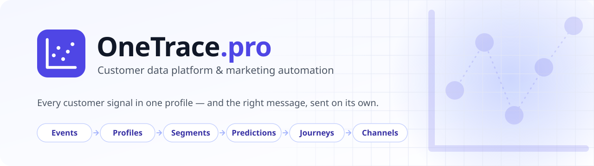

<a href="https://onetrace.pro/en/">
  <picture>
    <source media="(prefers-color-scheme: dark)" srcset="assets/banner-dark.svg">
    
  </picture>
</a>

<p align="center">
  <a href="https://onetrace.pro/en/"><b>Website</b></a> ·
  <a href="https://cdp.onetrace.pro/docs/en"><b>Help center</b></a> ·
  <a href="https://onetrace.pro/en/docs/api"><b>API reference</b></a> ·
  <a href="https://demo.onetrace.pro/"><b>Live demo store</b></a> ·
  <a href="https://onetrace.pro/en/pricing"><b>Pricing</b></a> ·
  <a href="https://onetrace.pro/en/demo"><b>Book a demo</b></a> ·
  <a href="https://onetrace.pro/">Русский</a>
</p>

**OneTrace.pro** is a customer data platform with marketing automation built in. It collects events from websites, apps and backends, merges them into a single customer profile, keeps segments and predictions up to date, and sends the right message to the right channel on its own — email, Web Push, SMS, Telegram, WhatsApp and Viber.

No need to glue together a CDP, an email service, product recommendations, site search and analytics from different vendors: it is one platform, and it can run under your brand.

## What it does

| | |
|---|---|
| **Collect** — JS tracker, server-side API, file imports, scheduled data sources, migration from Mindbox, Customer.io and Retail Rocket | **Unify** — identity resolution by email, phone and IDs; events, orders and messages of every customer in one profile |
| **Segment** — a condition builder over events and attributes, real-time and scheduled, syncs to Meta, Google Ads, Yandex Audiences and VK Ads | **Predict** — RFM, churn risk, purchase probability, predicted revenue and engagement for every profile, with model quality in plain sight |
| **Engage** — visual journeys with a template library, scheduled campaigns with A/B tests, quiet hours and frequency caps | **Deliver** — a built-in mail service sending from your domain (DKIM, warm-up, suppression list), or your own SMTP and messaging gateways |
| **Recommend** — popular, viewed and bought together, similar and personal products on your site, in emails and in journeys | **Search** — product search with suggestions, typo and keyboard-layout tolerance, ranked by what customers actually buy |
| **Analyze** — a project dashboard, channel and journey reports, segment dynamics, a live event stream | **White-label** — your name, colors, icon and domain; client projects, roles limited to specific resources, an audit log |

The interface is available in 10 languages. Try it for 14 days on the Growth plan — [no card required](https://cdp.onetrace.pro/register).

## Open source

Libraries and plugins that connect your stack to OneTrace. Each one is tested in CI against the platform versions it supports.

| Repository | What it is | Install |
|---|---|---|
| [**onetrace-php**](https://github.com/OneTracePro/onetrace-php) <br> [](https://packagist.org/packages/onetracepro/onetrace-php) | PHP client for the whole public API: events, profiles, products, recommendations, search, segments, journeys and campaigns. PHP 7.4–8.5, no required dependencies | `composer require onetracepro/onetrace-php` |
| [**onetrace-laravel**](https://github.com/OneTracePro/onetrace-laravel) <br> [](https://packagist.org/packages/onetracepro/onetrace-laravel) | Laravel integration: events after the response or via queues, a Blade directive for the tracker, automatic identify, Eloquent product sync, Octane support and a test fake | `composer require onetracepro/onetrace-laravel` |
| [**onetrace-woocommerce**](https://github.com/OneTracePro/onetrace-woocommerce) <br> [](https://github.com/OneTracePro/onetrace-woocommerce/releases/latest) | WooCommerce plugin: server-side orders and consents, the tracker, catalog sync, recommendation widgets, product search and Web Push | [Download the zip](https://github.com/OneTracePro/onetrace-woocommerce/releases/latest) |
| [**onetrace-magento2**](https://github.com/OneTracePro/onetrace-magento2) <br> [](https://packagist.org/packages/onetracepro/onetrace-magento2) | Magento 2 / Adobe Commerce module: the same e-commerce events, catalog and widgets, per store view | `composer require onetracepro/onetrace-magento2` |

Every shop plugin sends the same [e-commerce events](https://onetrace.pro/en/docs/api), so abandoned cart, browse abandonment, post-purchase and win-back journeys work right after you connect a store.

## Quick start

Put the tracker on your site — the write key is in your project's **API keys** section:

```html
<script>
  window.cdp = window.cdp || [];
  cdp.push(['init', 'cdp_wk_…', { host: 'https://cdp.onetrace.pro' }]);
  cdp.push(['page']);
</script>
<script async src="https://cdp.onetrace.pro/tracker/cdp.js"></script>
```

Then send orders and sign-ups from your backend:

```php
$onetrace = new OneTrace\Client('https://cdp.onetrace.pro', [
    'write_key' => getenv('ONETRACE_WRITE_KEY'),
    'secret_key' => getenv('ONETRACE_SECRET_KEY'),
]);

$onetrace->events()->track([
    'userId' => (string) $user->id,
    'event' => 'order_completed',
    'messageId' => 'order-A-1042', // a repeat within 24 hours is ignored
    'properties' => [
        'order_id' => 'A-1042',
        'amount' => 129.90,
        'products' => [['product_id' => 'SKU-1', 'quantity' => 2, 'price' => 64.95]],
    ],
]);
```

On a white-label brand, use the brand's domain instead of `cdp.onetrace.pro`.

## Get in touch

- Questions about the platform and your account — [support@onetrace.pro](mailto:support@onetrace.pro)
- Bugs and ideas for a library or plugin — an issue in its repository
- Security reports — see our [security policy](https://github.com/OneTracePro/.github/blob/main/SECURITY.md)
- A walkthrough on your own use case — [book a demo](https://onetrace.pro/en/demo)
